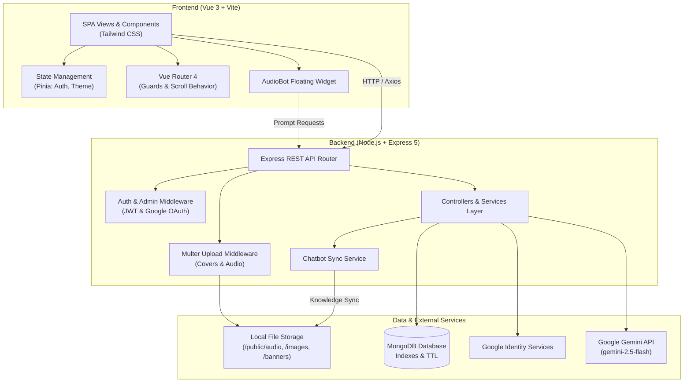

# 🎧 AudioTruyen — Full-Stack Audio & Web Novel Platform with AI Assistant

[](https://vuejs.org/)
[](https://vitejs.dev/)
[](https://tailwindcss.com/)
[](https://nodejs.org/)
[](https://expressjs.com/)
[](https://www.mongodb.com/)
[](https://ai.google.dev/)
[](LICENSE)

> A modern, full-featured web platform for reading web novels and streaming audiobooks. Built with a decoupled **Vue 3 (Vite + Tailwind CSS)** Single Page Application and a robust **Node.js (Express 5 + MongoDB)** RESTful backend, enhanced with an intelligent **Google Gemini-powered AI Assistant ("AudioBot")** and a comprehensive administrative portal.

---

## 📑 Table of Contents

- [Overview](#-overview)
- [Key Features](#-key-features)
  - [Reader & Public Experience](#reader--public-experience)
  - [Intelligent AI Assistant ("AudioBot")](#intelligent-ai-assistant-audiobot)
  - [Administrative Back-Office](#administrative-back-office)
- [System Architecture](#-system-architecture)
- [Tech Stack](#-tech-stack)
- [Project Directory Structure](#-project-directory-structure)
- [Database & Indexing Design](#-database--indexing-design)
- [Getting Started](#-getting-started)
  - [Prerequisites](#prerequisites)
  - [Backend Setup](#1-backend-setup)
  - [Frontend Setup](#2-frontend-setup)
- [Environment Variables](#-environment-variables)
- [REST API Endpoints](#-rest-api-endpoints)
- [Author & Acknowledgments](#-author--acknowledgments)

---

## 🌟 Overview

**AudioTruyen** bridges the gap between text novels and audiobooks. Users can immerse themselves in stories through clean typography or listen to chapters via an integrated HTML5 audio player. The system features a responsive UI with dark/light themes, Google OAuth 2.0 authentication, nested discussion threads, ratings, and a synchronized AI chatbot capable of answering questions about the story catalog in real-time.

---

## 🚀 Key Features

### Reader & Public Experience

- **Dual-Mode Consumption**: Read text chapters and listen to synchronized audio narrations.
- **Embedded Audio Player**: Custom controls with timeline seeking, duration display, and play/pause states.
- **Dynamic Theming**: Instant switching between Dark Mode and Light Mode with CSS custom properties.
- **Discovery & Exploration**:
  - Filter by Hot Stories (sorted by views), New Updates, and Completed (Full) stories.
  - Category-based and Author-based navigation.
  - Multi-field text search (story title, author, description).
- **Interactive Community**:
  - **Rating & Reviews**: 5-star scoring system with user reviews.
  - **Threaded Comments**: Multi-level nested replies, comment liking, and moderation reporting.
- **User Personalization**:
  - **Reading History**: Automatically tracks user progress with automatic cleanup via MongoDB TTL indexes (90-day retention).
  - **Favorite Stories**: Bookmark and quickly revisit saved titles.
  - **User Profile**: Personal account management, avatar uploads, and password updates.
- **Authentication & Security**:
  - Standard email/password registration with bcrypt password hashing.
  - Single Sign-On (SSO) via **Google OAuth 2.0**.
  - Secure stateless JWT session tokens.

### Intelligent AI Assistant ("AudioBot")

- **Powered by Google Gemini 2.5 Flash** (`@google/generative-ai`).
- **Dynamic RAG Context Synchronization**: Story metadata, categories, authors, and website details are synchronized from the database to localized text corpora (`chatbot_data/`).
- **Catalog-Aware Responses**: Directly answers user questions about story plots, genres, updates, and author information without requiring server restarts.

### Administrative Back-Office

- **Analytics Dashboard**: Real-time overview of stories, chapters, users, view counts, and 7-day activity metrics.
- **Story & Chapter Management**: Add, edit, or delete stories and chapters with chapter number sorting.
- **Media Asset Management**: Upload story cover images and chapter audio files (`.mp3`, `.wav`, etc.) using Multer storage pipelines.
- **Taxonomy Management**: Full CRUD operations for Authors and Categories with automatic slug generation.
- **Community Moderation**: Review user-flagged comments, resolve issues, or dismiss reports.
- **Marketing & Content Delivery**:
  - **Banner Carousel**: Control active homepage promotional sliders and display order.
  - **Advertisement System**: Placement-based ads (e.g., `chapter-detail`, sidebar) with scheduling date ranges.
- **System Settings**: Live configuration of website contact details, policies, and terms of service.

---

## 🏗 System Architecture



---

## 💻 Tech Stack

### Frontend

| Technology | Purpose |
| :--- | :--- |
| **Vue.js 3** (`Composition API`) | Core reactive user interface framework |
| **Vite 7** | Next-generation frontend build tool and dev server |
| **Pinia** | Centralized state management for authentication and theme preference |
| **Vue Router 4** | Client-side routing with navigation guards |
| **Tailwind CSS 3** | Utility-first responsive CSS styling |
| **Vee-Validate & Yup** | Form validation schemas |
| **FontAwesome Free** | Modern icon set |
| **Axios** | Promise-based HTTP client |

### Backend

| Technology | Purpose |
| :--- | :--- |
| **Node.js** | JavaScript runtime environment |
| **Express.js 5** | High-performance minimalist REST API framework |
| **MongoDB Driver** (v6 native) | Scalable NoSQL database connectivity |
| **JSON Web Token (JWT)** | Stateless bearer token authentication |
| **bcryptjs** | Salted password hashing |
| **Multer** | Multipart form-data handling for file uploads |
| **@google/generative-ai** | Google Gemini LLM integration for AudioBot |
| **Google Auth Library** | Google OAuth 2.0 credential verification |

---

## 📁 Project Directory Structure

```text
projet_NienLuan/
├── backend/                        # Express.js REST API
│   ├── app/
│   │   ├── config/                 # Application environment configurations
│   │   ├── controllers/            # Request handlers (Story, Chapter, User, Auth, etc.)
│   │   │   └── chatbot_controller/ # AI Chatbot controller
│   │   ├── middlewares/            # JWT authentication & Multer upload middleware
│   │   ├── routes/                 # Express API routes
│   │   ├── services/               # Core business logic & database services
│   │   │   └── chatbot_services/   # Gemini AI & knowledge sync services
│   │   ├── utils/                  # MongoDB client & create-indexes utility
│   │   └── api-error.js            # Standardized API error handler
│   ├── chatbot_data/               # Dynamic knowledge base for AI bot (.txt corpora)
│   ├── public/                     # Static media assets (audio, covers, banners, avatars)
│   ├── .env.example                # Backend environment variable template
│   ├── package.json
│   └── server.js                   # Application entry point & DB index initialization
│
├── frontend/                       # Vue 3 SPA Application
│   ├── public/                     # Static assets and icons
│   ├── src/
│   │   ├── assets/                 # Stylesheets, base themes & dark mode overrides
│   │   ├── components/             # Reusable UI components (Player, Chatbot, Cards, etc.)
│   │   ├── router/                 # Vue Router configuration & route guards
│   │   ├── services/               # Axios API client services
│   │   ├── stores/                 # Pinia stores (Auth, Theme)
│   │   ├── utils/                  # Media URL helpers (media.js)
│   │   ├── views/                  # Page views
│   │   │   ├── admin/              # Admin back-office views & dashboard
│   │   │   ├── auth/               # Login, Register, Google Callback
│   │   │   ├── category/           # Category listing & detail pages
│   │   │   ├── chapter/            # Chapter reading & audio listening view
│   │   │   ├── pages/              # Home, History, Favorites, Profile, Search, etc.
│   │   │   └── story/              # Story details, Hot, New, and Completed lists
│   │   ├── App.vue                 # Root Vue component
│   │   └── main.js                 # Frontend application bootstrap
│   ├── .env.example                # Frontend environment variable template
│   ├── package.json
│   ├── tailwind.config.js          # Tailwind CSS design system configuration
│   └── vite.config.js              # Vite server & API proxy configuration
│
└── README.md                       # Project documentation
```

---

## 🗄 Database & Indexing Design

The database layer utilizes native MongoDB driver optimizations with specialized indexing defined in `backend/app/utils/create-indexes.js`:

| Collection | Key Indexes | Purpose |
| :--- | :--- | :--- |
| `stories` | `{ name: "text", description: "text" }` | Full-text search on titles and synopsis |
| | `{ slug: 1 }` *(Unique, Sparse)* | SEO-friendly URL lookup |
| | `{ views: -1 }`, `{ updatedAt: -1 }` | Fast sorting for Hot and Latest stories |
| | `{ categories: 1, updatedAt: -1 }` | Compound index for filtered queries |
| `chapters` | `{ storyId: 1, chapterNumber: 1 }` | Rapid chapter retrieval and ordered listing |
| | `{ title: "text", content: "text" }` | Text search across chapter contents |
| `users` | `{ email: 1 }` *(Unique)* | Unique credential constraint |
| | `{ googleId: 1 }` *(Sparse)* | Google OAuth user matching |
| `histories` | `{ userId: 1, storyId: 1 }` *(Unique)* | Single history entry per user/story |
| | `{ lastReadAt: 1 }` *(TTL: 90 days)* | Automatic expiration and cleanup of old history |
| `ratings` | `{ userId: 1, storyId: 1 }` *(Unique)* | Ensures one rating per user per story |
| `comment_likes` | `{ commentId: 1, userId: 1 }` *(Unique)* | Prevents duplicate comment likes |
| `banners` | `{ isActive: 1, order: 1 }` | Sorted retrieval for active promotional sliders |
| `ads` | `{ isActive: 1, position: 1 }` | Targeted ad retrieval by page position |

---

## ⚡ Getting Started

### Prerequisites

Ensure you have the following installed on your machine:
- **Node.js** (v18.x or later)
- **npm** or **yarn** / **pnpm**
- **MongoDB** (v6.0 or later running locally or a MongoDB Atlas URI)
- A **Google Cloud Console Project** (for Google OAuth 2.0 Client ID & Secret)
- A **Google Gemini API Key** (from [Google AI Studio](https://aistudio.google.com/))

---

### 1. Backend Setup

1. **Navigate to the backend directory:**
   ```bash
   cd backend
   ```

2. **Install dependencies:**
   ```bash
   npm install
   ```

3. **Configure Environment Variables:**
   Create a `.env` file from the example:
   ```bash
   cp .env.example .env
   ```
   Edit `.env` and fill in your database credentials and API keys:
   ```env
   PORT=3000
   MONGODB_URI=mongodb://127.0.0.1:27017/audiotruyen
   JWT_SECRET=your_super_secret_jwt_key
   GOOGLE_CLIENT_ID=your_google_client_id.apps.googleusercontent.com
   GOOGLE_CLIENT_SECRET=your_google_client_secret
   GOOGLE_API_KEY=your_gemini_api_key
   ```

4. **Initialize Database Indexes (Optional):**
   *Note: Indexes are automatically checked and initialized on server startup.*
   ```bash
   npm run indexes:create
   ```

5. **Start the development server:**
   ```bash
   npm start
   ```
   The backend API will run at `http://localhost:3000`.

---

### 2. Frontend Setup

1. **Navigate to the frontend directory:**
   ```bash
   cd ../frontend
   ```

2. **Install dependencies:**
   ```bash
   npm install
   ```

3. **Configure Environment Variables:**
   Create a `.env` file from the example:
   ```bash
   cp .env.example .env
   ```
   Update `.env` with your frontend settings:
   ```env
   VITE_GOOGLE_CLIENT_ID=your_google_client_id.apps.googleusercontent.com
   VITE_API_BASE_URL=http://localhost:3000
   VITE_BACKEND_URL=http://localhost:3000
   ```

4. **Start the development server:**
   ```bash
   npm run dev
   ```
   The client application will run at `http://localhost:3001` (with `/api` proxied to port `3000`).

---

## 🔐 Environment Variables

### Backend (`backend/.env`)

| Variable | Description | Required | Default |
| :--- | :--- | :---: | :--- |
| `PORT` | Port for the Express server | No | `3000` |
| `MONGODB_URI` | Connection URI for the MongoDB instance | Yes | `mongodb://127.0.0.1:27017/contactbook` |
| `JWT_SECRET` | Secret key used for signing JWT authentication tokens | Yes | - |
| `GOOGLE_CLIENT_ID` | Google OAuth 2.0 Web Client ID | Yes | - |
| `GOOGLE_CLIENT_SECRET` | Google OAuth 2.0 Client Secret | Yes | - |
| `GOOGLE_API_KEY` | Google Gemini AI API key for AudioBot | Yes | - |

### Frontend (`frontend/.env`)

| Variable | Description | Required | Default |
| :--- | :--- | :---: | :--- |
| `VITE_GOOGLE_CLIENT_ID` | Public Google Client ID for OAuth login | Yes | - |
| `VITE_API_BASE_URL` | Base endpoint for the backend API | Yes | `http://localhost:3000` |
| `VITE_BACKEND_URL` | URL used for resolving media assets | Yes | `http://localhost:3000` |

---

## 📡 REST API Endpoints

### 🔐 Authentication (`/api/auth`)
| Method | Endpoint | Description | Access |
| :--- | :--- | :--- | :--- |
| `POST` | `/api/auth/register` | Register a new user | Public |
| `POST` | `/api/auth/login` | Authenticate with email & password | Public |
| `GET` | `/api/auth/google` | Initiate Google OAuth redirect | Public |
| `POST` | `/api/auth/google/callback` | Exchange authorization code for JWT | Public |

### 📚 Stories (`/api/stories`)
| Method | Endpoint | Description | Access |
| :--- | :--- | :--- | :--- |
| `GET` | `/api/stories` | Retrieve paginated stories list | Public |
| `GET` | `/api/stories/search` | Search stories by keyword | Public |
| `GET` | `/api/stories/new` | Retrieve newest story releases | Public |
| `GET` | `/api/stories/hot` | Retrieve most-viewed stories | Public |
| `GET` | `/api/stories/full` | Retrieve completed stories | Public |
| `GET` | `/api/stories/slug/:slug` | Get story details by unique slug | Public |
| `POST` | `/api/stories` | Create a new story | Admin |
| `PUT` | `/api/stories/:id` | Update story details | Admin |
| `DELETE` | `/api/stories/:id` | Delete a story | Admin |
| `POST` | `/api/stories/upload-cover/:storyId` | Upload story cover image | Admin |

### 📖 Chapters (`/api/chapters`)
| Method | Endpoint | Description | Access |
| :--- | :--- | :--- | :--- |
| `GET` | `/api/chapters/story/:storyId` | Get all chapters for a story | Public |
| `GET` | `/api/chapters/:id` | Get specific chapter content and audio | Public |
| `POST` | `/api/chapters` | Add a new chapter | Admin |
| `PUT` | `/api/chapters/:id` | Update chapter content | Admin |
| `DELETE` | `/api/chapters/:id` | Delete a chapter | Admin |
| `POST` | `/api/chapters/upload-audio/:storyId/:chapterNumber` | Upload audio narration file | Admin |

### 🤖 Chatbot (`/api/chatbot`)
| Method | Endpoint | Description | Access |
| :--- | :--- | :--- | :--- |
| `POST` | `/api/chatbot` | Send prompt to Gemini AI AudioBot | Public |
| `POST` | `/api/chatbot/sync` | Trigger knowledge base sync from DB | Admin |

### 👤 User Services & Interactions
| Resource | Base Endpoint | Features |
| :--- | :--- | :--- |
| **Favorites** | `/api/favorites` | Add, remove, and list bookmarked stories |
| **History** | `/api/history` | Log chapter reading and retrieve reading progress |
| **Ratings** | `/api/ratings` | Submit story ratings (1–5 stars) & view rating averages |
| **Comments** | `/api/comments` | Post comments, reply in threads, like, and report comments |
| **Statistics** | `/api/statistics` | Retrieve overview statistics and 7-day activity |
| **Banners & Ads**| `/api/banners`, `/api/ads` | Fetch and manage marketing sliders and display ads |

---

## 👨‍💻 Author & Acknowledgments

- **Developer**: [Ngo Minh Huy](https://github.com/minhhuy2k4)
- **Project Type**: Graduation / Capstone Project (*Đồ Án Niên Luận*)
- **Repository**: [projet_NienLuan](https://github.com/minhhuy2k4/projet_NienLuan)

*Built with passion for digital reading and multimedia web applications.*

